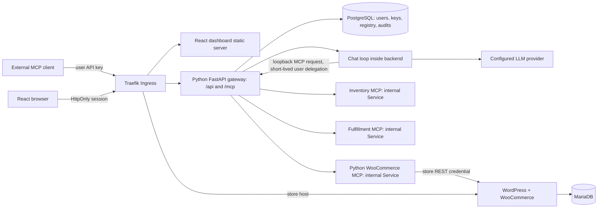

# System design: Python team MCP gateway

Status: architecture accepted for implementation, 12 October 2026. The store foundation is deployed in this phase. Gateway, MCP services, chat and React dashboard are planned; they are not claimed as implemented.

## Scope and boundaries

Build the mandatory single-store platform first. One team in the initial deployment (no cross-organization tenancy claim), two roles, at least two users, three Streamable HTTP upstreams, one gateway MCP endpoint, a React dashboard, and a tool-using chat agent. Optional multi-store provisioning, OAuth, hosted container provisioning, and distributed session storage are deferred until the core acceptance flow works.

Only the gateway connects to upstream MCP servers. The browser never knows upstream credentials. The WooCommerce MCP server uses the authenticated `wc/v3` REST API; it never queries WordPress tables directly. PostgreSQL is for the platform; MariaDB is for WordPress. These databases have separate passwords and volumes.

## Runtime and repository

- Python 3.12, FastAPI/Starlette, official Python MCP SDK, HTTPX, Pydantic, SQLAlchemy async + asyncpg, Alembic.
- React + TypeScript + Vite for the dashboard, served as a separate static workload. Dashboard API and MCP routes share the gateway host to simplify cookie and CORS rules.
- One Python gateway workload initially, with separate modules for administration, authentication, policy, discovery, routing, audit and chat. Avoid premature microservices while preserving those code boundaries.
- Separate WooCommerce MCP workload; two additional small, real demo upstream services for inventory/fulfillment. Declare demo data clearly. Cross-server example: find today's orders in WooCommerce and match their SKUs against inventory/fulfillment data.
- Helm owns the store, databases, application Services, Deployments, ingress and policies. Secrets are supplied separately; charts reference Secret names.

`services/gateway/`, `services/woocommerce_mcp/`, and `apps/dashboard/` reserve the service boundaries. Locked Python dependencies live in `uv.lock`. Choose SDK features against that installed release, not code copied from a newer branch.

## Request path and identity

1. HTTP authentication creates a trusted Principal (user ID, role, key ID or dashboard session ID).
2. `tools/list` reads the registry and discovered schemas, excludes disabled servers, filters permissions, and returns deterministic gateway tool names.
3. `tools/call` resolves a stored routing map. Recheck current key status, current server enablement and permissions; never rely on discovery as authorization.
4. Insert an audit intent before sending upstream traffic. If audit persistence fails, reject the call before side effects occur.
5. Decrypt only the chosen server credential, construct an allowlisted static auth header, and invoke that upstream through the MCP SDK.
6. Finish the audit with outcome, duration, error category and correlation ID. Return a bounded tool result. No credential headers are copied from the incoming request.

Rejected tool attempts (revoked known key, disabled server, denied tool or invalid arguments) also produce audit records with available identity and a rejection reason. Unknown anonymous callers are recorded without inventing a user; never log the presented token. Failure to persist an audit before an allowed tool dispatch blocks that dispatch.

API keys use a random secret and public lookup ID, with a keyed one-way hash stored in PostgreSQL. Compare digests in constant time. The hashing key is a Kubernetes Secret; API keys are displayed once. Dashboard sessions use separate random, hashed session tokens in HttpOnly cookies, with CSRF protection on writes. Browser-supplied user IDs are never accepted as identity.

Chat is hosted in the gateway backend but calls `/mcp` through an actual MCP client over loopback. The backend creates a short-lived delegation token containing the authenticated user ID and a chat-only audience. The `/mcp` boundary validates it and reconstructs the same Principal; it does not let a browser mint or use this token. Each chat tool call follows the same authorization and audit path as external clients. Raw user API keys need not be stored or recovered for chat.

## MCP protocol and session decisions

Use Streamable HTTP with the locked official Python SDK. Baseline tools-only functionality uses stateless downstream HTTP transport and JSON responses where supported. Declare and verify protocol negotiation against MCP Inspector and one target client before extending optional capabilities. Do not advertise sampling, elicitation, resources, prompts, subscriptions or resumability until implemented.

Upstreams may be stateful even when our gateway is stateless. Each gateway replica owns bounded SDK client sessions keyed by server ID and registry revision, with the upstream session ID retained only in that replica. Serialize or pool sessions according to the SDK's concurrency behavior. Registry edits close the old session and discard old tool schemas. A lost upstream session can be reinitialized for discovery; never replay a write with an uncertain outcome.

This is not a transparent byte proxy: the gateway terminates downstream MCP, acts as an independent upstream MCP client, applies policy, and rewrites tool identity.

## Discovery, tool names and state

Use a gateway-assigned immutable server alias, not an upstream's self-reported server name. Public tool names follow `alias__tool`, restricted to permitted characters and length. If normalization or truncation creates collisions, append a short stable hash and keep an explicit `(public name -> server UUID, original upstream name)` map. Never reconstruct routing by splitting names. Alias changes are intentionally unsupported initially; display names are editable.

Discovery has per-server deadlines and bounded parallelism. Store validated input schemas, original tool names, tool descriptions, schema hashes, timestamps and errors in PostgreSQL. Bound tool count, schema complexity, description length and result size. Schema changes invalidate cached catalogs; optional tool approvals can later pin schema hashes.

Status precedence: Disabled when the admin switch is off; Unreachable after the last discovery/connectivity check fails; Connected after a successful MCP handshake/discovery. Display last check, reason and last success. A cached catalog from an unreachable enabled server can remain discoverable, marked stale in the dashboard; its calls return an explicit unavailable error. The brief only requires disabled server tools to disappear. Document this distinction rather than hiding an outage behind an empty list.

`tools/list` must not synchronously wait on every upstream. Background checks refresh the catalog. Edits and disables invalidate caches immediately. Every call rereads enablement and grants in PostgreSQL. For external clients that cache catalogs, demonstrate re-list/reconnect; do not claim every client's UI refreshes instantly without implemented notifications.

## Failure handling and concurrency

- Independent connect/read deadlines per upstream, plus a gateway deadline and bounded queue. Initial defaults: 5 seconds connect, 20 seconds tool call, 5 seconds discovery; make them configurable.
- Per-upstream semaphore isolates a slow server; a separate global cap limits total in-flight work. Reserve enough capacity that one upstream cannot consume all gateway slots.
- Circuit breaker after repeated failures, with capped backoff and half-open probes. Distinguish timeout, authentication, invalid schema, upstream error, disabled server and permission denial.
- Do not automatically retry product creation or status changes. A timeout may mean a committed write whose response was lost. Audit as `unknown_outcome`, explain it to the caller, and reconcile through a read.
- Metadata/read-only retries may use capped jitter when demonstrably safe; do not trust a malicious server's read-only annotation as permission to replay.
- Gateway liveness checks its own process. Readiness checks PostgreSQL and migration compatibility; an upstream outage never fails gateway readiness.
- Audit reconciliation marks interrupted in-flight records unknown after a restart; it cannot manufacture exactly-once execution.

## Load balancing and scaling

Traefik terminates public HTTP/TLS and forwards to Kubernetes Services. Services route only to ready pods. Begin with one gateway replica, one WordPress replica and one instance of each database. This is deployable on one VPS but is not high availability.

Stateless downstream MCP avoids gateway-session affinity. If adding downstream stateful SSE sessions, explicitly choose affinity plus recovery or external session ownership; a cookie alone is not sufficient for CLI MCP clients. Upstream sessions remain local to gateway replicas and must be recreated on restart. Arbitrary stateful upstreams with multiple pods require session-aware upstream routing; a plain Service can send the next call to the wrong pod. Our own MCP services should use stateless transport.

For two gateway replicas, share PostgreSQL registry/audits/keys, check revocation on every request, version catalog records and propagate invalidation (PostgreSQL NOTIFY plus revision checks). Leader-election/advisory lock can limit health-check duplication. Per-replica limits are not a global rate limit; add Redis or a database-backed limiter only when demonstrating scaling. Budget DB pool size across replicas and background workers.

WordPress stays at one replica because of writable content and background-job semantics. Multiple replicas require RWX/object storage, coordinated cron, shared cache/session review and measured database capacity. Increasing replicas in Helm alone would not solve this. Database failover, replicated storage and backup recovery are separate production work.

## Data model to implement

| Table | Key responsibilities |
| --- | --- |
| users | identity, password hash, role, active state |
| memberships/invitations | scoped invitation token hash, expiration, role |
| api_keys | user FK, public key ID, hash, created/revoked timestamps |
| sessions | hashed cookie token, user FK, expiration |
| upstream_servers | immutable alias, URL, enabled, encrypted credential, revision |
| discovered_tools | server FK, original/public tool names, schema, hash, discovery time |
| tool_grants | user/role grants enforced at discovery and call time |
| upstream_health | check time, last success, reason, state |
| audit_calls | principal, key/session, server/tool snapshot, start/end, outcome, trace ID |
| chat_messages | user/conversation, messages and bounded tool traces |

Use foreign keys and transactions. Removed servers and users must not erase historical audits; keep snapshots or soft-delete records. Do not store raw credentials, API keys, customer addresses or full tool payloads in audit metadata.

## Security decisions

Encrypt dynamic upstream credentials in PostgreSQL using an application encryption key supplied via Kubernetes Secret. This permits dashboard registration without granting the gateway Kubernetes Secret CRUD rights. Bootstrap/store/LLM/encryption secrets remain Kubernetes Secrets. Document this distinction: encrypted upstream records are secret material too.

Admin URL registration needs two destination classes: predefined cluster services that match an explicit service/namespace allowlist, and external HTTPS destinations. Block metadata, loopback, link-local, cluster control plane and private destinations outside that allowlist. Check all resolved addresses and redirects; prevent DNS rebinding at connection time, constrain egress, and never forward the incoming authorization header. Registered local MCP Services are allowed intentionally, not via a blanket private-IP exception.

Untrusted upstream descriptions and outputs are data. Permissions and allowed arguments are enforced outside the model. Label origin, limit output, prohibit cross-user session access, and add explicit user confirmation for sensitive chat writes. Model confirmation is not authorization. Suppress PII in ordinary order summaries; provide only the fields needed for the question.

Default-deny NetworkPolicies apply to application pods. Explicitly permit DNS, ingress-to-WordPress, WordPress-to-MariaDB, gateway-to-PostgreSQL and gateway-to-MCP. Check CNI enforcement with a denied connection test. Disable service-account token mounting for components with no Kubernetes API need. Official WordPress/database entrypoints initially need root for initialization; do not claim all containers run as non-root. The bootstrap job runs as UID 33. Harden custom Python workloads as non-root when added.

## Research comparison

| Reference | Relevant pattern | Choice for this assignment |
| --- | --- | --- |
| Agentgateway | control/data-plane separation; virtual MCP aggregation; session-aware routing | separate modules and registry revisions inside our Python backend; no xDS controller required |
| Agentgateway load balancing | health-aware pod selection and session-aware backends | Kubernetes Service balancing for stateless services; explicitly document stateful upstream limitations |
| LiteLLM | fixed MCP endpoint; namespaced tools; key/team permissions; two auth layers | shared server-side upstream credential, independent user auth, permissions on list and call |
| Official Python MCP SDK | Streamable HTTP clients and servers, stateless transport support | SDK handles protocol; our code owns policy, lifecycle, audit and routing |

References checked 12 October 2026:
- https://agentgateway.dev/docs/kubernetes/latest/documentation/about/architecture/
- https://agentgateway.dev/docs/kubernetes/latest/documentation/mcp/session/
- https://agentgateway.dev/docs/kubernetes/latest/documentation/traffic-management/load-balancing/
- https://docs.litellm.ai/docs/mcp/
- https://docs.litellm.ai/docs/mcp_config_reference
- https://github.com/modelcontextprotocol/python-sdk
- https://developer.woocommerce.com/docs/apis/rest-api/

Research informs our design; these products are not substituted for the gateway we must implement.
