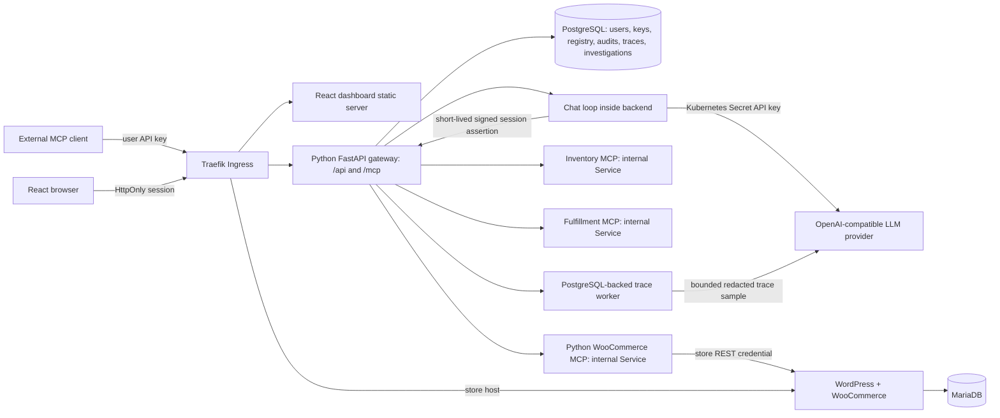

# System design: Python team MCP gateway

Status (20 October 2026): gateway foundation, dashboard control plane, chat tool loop, model/tool traces, routing, on-demand trace investigation and runtime controls are implemented (ADRs 003–006). The local cluster is configured with Gemini 3.8 Flash. Chat created product #16; visible storefront COD order #19 and Store API order #17 were placed for it and verified in WooCommerce admin. Chat returned #19 when asked for today's orders. User B accessed today's orders and inventory through the external MCP endpoint, used a cross-server chat prompt, and had both issued test keys revoked with subsequent MCP requests rejected by HTTP 401. The live PostgreSQL limiter concurrency check and automated OIDC/circuit behavior tests pass. `/metrics` serves valid exposition inside the gateway pod, but scraper pod access is not yet verified in local k3d. A live OIDC provider login and production-like VPS deployment need provider registration and target infrastructure. The demo video and submission are the user's deliverables.

## Scope and boundaries

Build the mandatory single-store platform first. One team in the initial deployment (no cross-organization tenancy claim), two roles, at least two users, three Streamable HTTP upstreams, one gateway MCP endpoint, a React dashboard, and a tool-using chat agent. Optional multi-store provisioning, OAuth, hosted container provisioning, and distributed session storage are deferred until the core acceptance flow works.

Only the gateway connects to upstream MCP servers. The browser never knows upstream credentials. The WooCommerce MCP server uses the authenticated `wc/v3` REST API (ADR 002 documents canonical-URL signing and internal-only deployment); it never queries WordPress tables directly. PostgreSQL is for the platform; MariaDB is for WordPress. These databases have separate passwords and volumes.

## Runtime and repository

- Python 3.12, FastAPI/Starlette, official Python MCP SDK, HTTPX, Pydantic, SQLAlchemy async + asyncpg, Alembic.
- React + TypeScript + Vite for the dashboard, served as a separate static workload. Dashboard API and MCP routes share the gateway host to simplify cookie and CORS rules.
- One Python gateway workload initially, with separate modules for administration, authentication, policy, discovery, routing, audit and the chat tool loop. Avoid premature microservices while preserving those code boundaries.
- Separate WooCommerce MCP workload; two additional small, real demo upstream services for inventory/fulfillment. Declare demo data clearly. Cross-server example: find today's orders in WooCommerce and match their SKUs against inventory/fulfillment data.
- Helm owns the store, databases, application Services, Deployments, ingress and policies. Secrets are supplied separately; charts reference Secret names.

`services/gateway/`, `services/demo_mcp/`, `services/woocommerce_mcp/`, and `apps/dashboard/` implement the service boundaries. Locked Python dependencies live in `uv.lock`. The gateway and dashboard are deployed by the same Helm chart as the store.

## Request path and identity

1. HTTP authentication creates a trusted Principal (user ID, role, key ID or dashboard session ID). Dashboard chat requires the normal session cookie and CSRF token; no browser-supplied ID becomes identity.
2. `tools/list` reads the registry and discovered schemas, excludes disabled servers, filters permissions, and returns deterministic gateway tool names.
3. `tools/call` resolves a stored routing map. Recheck current key status, current server enablement and permissions; never rely on discovery as authorization.
4. Insert an audit intent before sending upstream traffic. If audit persistence fails, reject the call before side effects occur.
5. Decrypt only the chosen server credential, construct an allowlisted static auth header, and invoke that upstream through the MCP SDK.
6. Finish the audit with outcome, duration, error category and correlation ID. Return a bounded tool result. No credential headers are copied from the incoming request.

Rejected tool attempts (revoked known key, disabled server, denied tool or invalid arguments) also produce audit records with available identity and a rejection reason. Unknown anonymous callers are recorded without inventing a user; never log the presented token. Failure to persist an audit before an allowed tool dispatch blocks that dispatch.

API keys use a random secret and public lookup ID, with a keyed one-way hash stored in PostgreSQL. Compare digests in constant time. The hashing key is a Kubernetes Secret; API keys are displayed once. Dashboard sessions use separate random, hashed session tokens in HttpOnly cookies, with CSRF protection on writes. Browser-supplied user IDs are never accepted as identity.

Dashboard chat is hosted in the gateway backend and uses the official MCP client to call the same local `/mcp` endpoint that external clients use. The backend mints a two-minute HMAC-signed assertion bound to the authenticated dashboard user and session; MCP middleware checks its signature, expiry, live WebSession and active user on every request. This keeps the browser's cookie as the only client credential and makes each chat tool call use the same current permission, enablement, routing and audit path. Logging out deletes the source session, which invalidates an assertion immediately. The LLM base URL and model profiles are Helm values; an optional provider key comes only from a Kubernetes Secret. Set a LiteLLM Auto Router alias to delegate task classification, or use the local deterministic rule to send cross-server or multi-step prompts to the complex profile and other prompts to the standard profile. Per invocation, the gateway records model/provider, route tier and reason, token usage, latency and outcome. Cost is estimated from explicit per-model token rates; missing rates are shown as unpriced. By default, traces keep only this metadata. When trace content capture is enabled, the gateway stores bounded, heuristic-redacted user/assistant/tool previews for the short configured TTL; it never stores system prompts or hidden reasoning. Local values enable this only for synthetic demo data; production values disable it. An admin can queue an on-demand investigation over a frozen, bounded sample, add expected behavior and checks, and inspect grouped findings linked to verified evidence. The worker uses the configured analysis model, no tools, explicit model pricing and a per-run cap. The provider is absent in the current local deployment, so model-backed chat and investigation behavior are not yet verified.

## MCP protocol and session decisions

Use Streamable HTTP with the locked official Python SDK. Baseline tools-only functionality uses stateless downstream HTTP transport and JSON responses where supported. Declare and verify protocol negotiation against MCP Inspector and one target client before extending optional capabilities. Do not advertise sampling, elicitation, resources, prompts, subscriptions or resumability until implemented.

Upstreams may be stateful even when our gateway is stateless. Each gateway replica owns an SDK client session per server ID and registry revision, with the upstream session ID retained only in that replica. A dedicated asyncio worker owns each session's lifetime and processes its commands serially, keeping the SDK's AnyIO task group inside the task that created it. Separate server workers remain independent. Registry URL, credential, enablement or removal changes queue a close command to the worker. A failed session is discarded and can be reinitialized on a later discovery; never replay a write with an uncertain outcome.

This is not a transparent byte proxy: the gateway terminates downstream MCP, acts as an independent upstream MCP client, applies policy, and rewrites tool identity.

## Discovery, tool names and state

Use a gateway-assigned immutable server alias, not an upstream's self-reported server name. Public tool names follow `alias__tool`, restricted to permitted characters and length. If normalization or truncation creates collisions, append a short stable hash and keep an explicit `(public name -> server UUID, original upstream name)` map. Never reconstruct routing by splitting names. Alias changes are intentionally unsupported initially; display names are editable.

Discovery has per-server deadlines and runs concurrently across servers. Store validated input schemas, original tool names, tool descriptions, schema hashes and discovery timestamps in PostgreSQL. Bound tool count, schema size, description length and result size. A failed discovery preserves the last known catalog and records the reason. A member grant is cleared if its tool disappears or its discovered schema hash changes; an admin must explicitly grant the changed tool again.

Status precedence: Disabled when the admin switch is off; Unreachable after the last discovery/connectivity check fails; Connected after a successful MCP handshake/discovery. The dashboard displays last check, error and last success. The cached catalog from an unreachable enabled server remains discoverable while the dashboard marks it unavailable; calls fail clearly. Disabled server tools are omitted from the gateway catalog.

`tools/list` reads PostgreSQL and does not contact upstreams. Startup and a periodic loop refresh catalogs. Upstream URL/credential, enablement and removal changes schedule session invalidation; a successful refresh replaces that server's catalog. Every call rereads enablement and grants in PostgreSQL. For external clients that cache catalogs, re-list/reconnect after a change; the gateway does not yet send catalog-change notifications.

## Scale patterns from large MCP gateways

Uber's control-plane/data-plane split maps to this project as the PostgreSQL-backed server/tool registry and dashboard on the control side, with the gateway's authenticated MCP dispatch path on the execution side. New admin-added servers start disabled. A server owner/admin enables the server, and workspace member grants are checked both when listing and invoking tools. Existing MCP servers already provide their own schemas, so Protobuf/Thrift API scanning and generated-tool review are not needed for this assessment.

The current catalog has twelve tools across three servers, so the gateway returns the permission-filtered catalog through standard `tools/list`; this keeps the required external-client demonstration simple. If the catalog grows enough to overwhelm model context, add a discovery layer that searches the approved catalog, returns selected schemas, then invokes through the same audited dispatcher. Response projection (allowlisted response paths) and a CLI/code-mode client are not implemented. They need explicit schemas, output correctness checks, and authorization parity before adoption; they must not become alternate paths around the gateway's call-time policy or audit.

## Failure handling and concurrency

- Connection and MCP operations have configurable timeouts (3 seconds maximum connect timeout, 20 seconds tool call, 5 seconds discovery by default). One async lock per server serializes its calls and discovery; a slow server does not hold another server's lock. There is not yet a separate global concurrency cap.
- An atomic PostgreSQL fixed-window limiter covers external MCP requests and dashboard chat turns. It shares counters between replicas that use the same database and returns standard rate-limit headers. It limits request volume, not model token spend.
- A per-upstream circuit breaker opens after a configurable number of consecutive MCP transport/protocol failures. It rejects calls during a cooldown and allows one serialized half-open attempt. No operation is replayed. Breaker state is process-local, so it is not coordinated across gateway replicas.
- Periodic probes and status tracking provide health isolation. Exponential probe backoff remains deferred.
- Distinguish permission denial, invalid arguments, timeout, unreachable transport, protocol failure and upstream tool error in responses and audit records.
- Do not automatically retry product creation or status changes. A timeout may mean a committed write whose response was lost. Audit as `unknown_outcome`, explain it to the caller, and reconcile through a read.
- No MCP tool call is automatically retried. A timeout/transport interruption after dispatch is recorded as `unknown_outcome`, with guidance to reconcile through a read.
- Gateway liveness checks its process. Startup checks PostgreSQL schema availability; readiness checks PostgreSQL. An upstream outage never fails gateway readiness.
- Audit reconciliation marks interrupted in-flight records unknown after a restart; it cannot manufacture exactly-once execution.

## Load balancing and scaling

Traefik terminates public HTTP/TLS and forwards to Kubernetes Services. Services choose ready pods when establishing connections. A long-lived upstream MCP client session can remain connection-pinned to its selected pod, so the gateway does not provide per-call pod balancing. Begin with one gateway replica, one WordPress replica and one instance of each database. This is deployable on one VPS but is not high availability. There is no gateway-managed weighted or latency-aware upstream pool.

Stateless downstream MCP avoids gateway-session affinity. If adding downstream stateful SSE sessions, explicitly choose affinity plus recovery or external session ownership; a cookie alone is not sufficient for CLI MCP clients. Upstream sessions remain local to gateway replicas and must be recreated on restart. Arbitrary stateful upstreams with multiple pods require session-aware upstream routing; a plain Service can send the next call to the wrong pod. Our own MCP services should use stateless transport.

The current Helm deployment pins the gateway at one replica. Each call checks current database revocation and grants, so identity checks and rate-limit counters are shared-state safe, and downstream HTTP is stateless. Upstream sessions and circuit-breaker state are process-local; each replica would establish its own MCP session. Duplicate discovery probes, process-local breakers and DB pool sizing still need a scale test before raising replicas.

WordPress stays at one replica because of writable content and background-job semantics. Multiple replicas require RWX/object storage, coordinated cron, shared cache/session review and measured database capacity. Increasing replicas in Helm alone would not solve this. Database failover, replicated storage and backup recovery are separate production work.

## Current persistence model and chat state

| Table | Key responsibilities |
| --- | --- |
| users | identity, password hash, role, active state |
| `users` | identity, Argon2 password hash, admin/member role, active state |
| `invitations` | one-time token digest, target email, expiration, accepted time, role |
| `api_keys` / `web_sessions` | user FK, keyed digest, created/revoked/expiry state |
| `upstream_servers` | immutable alias, URL, encrypted credential, revision, enabled and health state; member grants are an allowlist on the server row |
| `discovered_tools` | server FK, original/public tool names, JSON schemas, schema hash, discovery time |
| `tool_audits` | principal/key, server/tool snapshot, start/end, outcome and error category |
| `agent_traces` / `agent_observations` | chat-turn summary plus ordered model-generation and gateway-tool spans, usage/cost/latency, routing reason and optional bounded redacted previews |
| `agent_investigations` / `investigation_runs` / `investigation_findings` | admin-owned expected behavior and checks, frozen trace sample, idempotent queued run, analysis model usage/cost, evidence-linked findings, feedback and resolution state |
| Chat history | recent user/assistant text is held in dashboard memory and sent back as bounded context; tool calls/results are not persisted as conversation rows, while every dispatched MCP tool call is stored in `tool_audits` |

The Observability dashboard combines chat-generation telemetry with existing MCP tool audits. It shows model calls, provider-reported input/output token usage, configured-price estimates, unpriced call counts, p95 latency, server tool health and step-level traces. Members can inspect only their own traces; admins can inspect the workspace. The first implementation reads a bounded 1–30 day window from PostgreSQL and is intended for the assessment workload, not a high-volume analytics store. The gateway also exports HTTP, MCP tool and circuit-breaker metrics at `/metrics`; Ingress does not publish this route, and NetworkPolicy permits scraper pods only when their namespace and pod labels are configured in Helm. Provider-reported usage is used when present; no provider-independent tokenizer is claimed. Investigation preflight uses a conservative byte-based upper bound, not exact tokenization. The admin-only Investigations view samples at most the configured trace count (25 by default), limits input and output size, records model usage/cost, validates every evidence quote against the source step, and makes no unsupported claim when evidence is missing. It remains on-demand only; there is no OTLP ingestion, scheduled monitoring or evaluation dataset manager. It should not be described as equivalent to Lens at swarm scale.

Trace previews are best-effort redacted and still sensitive. They are cleared within five minutes after the configured TTL (7 days by default). Investigation run/finding metadata currently has no purge policy, which must be decided before production use. See [ADR 005](decisions/005-lens-inspired-investigations.md) and the [Lens reference study](research/litellm-lens-reference.md).

Use foreign keys and transactions. Removed servers and users must not erase historical audits; keep snapshots or soft-delete records. Do not store raw credentials, API keys, customer addresses or full tool payloads in audit metadata.

## Security decisions

Encrypt dynamic upstream credentials in PostgreSQL using an application encryption key supplied via Kubernetes Secret. This permits dashboard registration without granting the gateway Kubernetes Secret CRUD rights. Bootstrap/store/LLM/encryption/OIDC client secrets remain Kubernetes Secrets. Document this distinction: encrypted upstream records are secret material too.

OIDC is an optional dashboard sign-in path alongside the local password flow. It uses authorization code with PKCE, a signed short-lived state cookie, issuer/audience/signature validation, nonce checking and verified email. It maps only to an existing active invited account; it does not auto-provision users or change their role. It does not replace per-user API keys for external MCP clients.

This deployment remains single-tenant: one team shares a PostgreSQL database and server registry. User IDs scope keys, sessions and traces, while role/grant rules scope tools. Separate tenant IDs, workspace routing, per-tenant quotas and row-level isolation are not implemented; a separate Helm release/database is the current isolation boundary between deployments. No WebAssembly extension runtime is included: an executable policy ABI, module trust/distribution flow, resource limits and upgrade/revocation rules must be designed before accepting plugins.

URL registration allows configured internal service hostnames and external HTTPS names. IP literals, local-only names, external HTTP, embedded URL credentials, non-public DNS answers and redirects are rejected. DNS is rechecked before each new upstream connection. Because DNS validation and the HTTP client's resolution are separate operations, the current code does not pin an address against a DNS-rebinding race; default-deny egress plus a public-IPv4 allow rule excluding private, loopback and link-local ranges is the network-layer backstop. NetworkPolicy/CNI enforcement must be verified on the target cluster. Never forward the incoming authorization header.

Untrusted upstream descriptions and outputs are data. Permissions and allowed arguments are enforced outside the model. Label origin, limit output, prohibit cross-user session access, and add explicit user confirmation for sensitive chat writes. Model confirmation is not authorization. Suppress PII in ordinary order summaries; provide only the fields needed for the question.

Default-deny NetworkPolicies apply to stack pods. Explicitly permit DNS, ingress-to-WordPress/dashboard/gateway, WordPress-to-MariaDB, gateway-to-PostgreSQL/MCP and gateway HTTPS egress. The chart disables service-account token mounting and applies non-root, read-only root filesystems and dropped capabilities to the dashboard and custom MCP/gateway containers. Official database/WordPress images use their own initialization entrypoints and are not claimed as wholly non-root. CNI enforcement still requires runtime verification.

## Research comparison

| Reference | Relevant pattern | Choice for this assignment |
| --- | --- | --- |
| Agentgateway | control/data-plane separation; virtual MCP aggregation; session-aware routing | separate modules and registry revisions inside our Python backend; no xDS controller required |
| Agentgateway load balancing | health-aware pod selection and session-aware backends | Kubernetes Service balancing for stateless services; explicitly document stateful upstream limitations |
| LiteLLM | fixed MCP endpoint; namespaced tools; key/team permissions; two auth layers | shared server-side upstream credential, independent user auth, permissions on list and call |
| Official Python MCP SDK | Streamable HTTP clients and servers, stateless transport support | SDK handles protocol; our code owns policy, lifecycle, audit and routing |

References checked 12 October 2026:
- https://agentgateway.dev/docs/kubernetes/latest/documentation/about/architecture/
- https://agentgateway.dev/docs/kubernetes/latest/documentation/mcp/session/
- https://agentgateway.dev/docs/kubernetes/latest/documentation/traffic-management/load-balancing/
- https://docs.litellm.ai/docs/mcp/
- https://docs.litellm.ai/docs/mcp_config_reference
- https://github.com/modelcontextprotocol/python-sdk
- https://developer.woocommerce.com/docs/apis/rest-api/

Research informs our design; these products are not substituted for the gateway we must implement.

Additional references for traces and routing: [Langfuse token and cost tracking](https://langfuse.com/docs/observability/features/token-and-cost-tracking), [Langfuse trace best practices](https://langfuse.com/docs/observability/best-practices), and [LiteLLM Lens](https://docs.litellm.ai/blog/litellm-lens-launch). See [ADR 004](decisions/004-chat-observability-and-routing.md) for the adopted subset and known limits.
